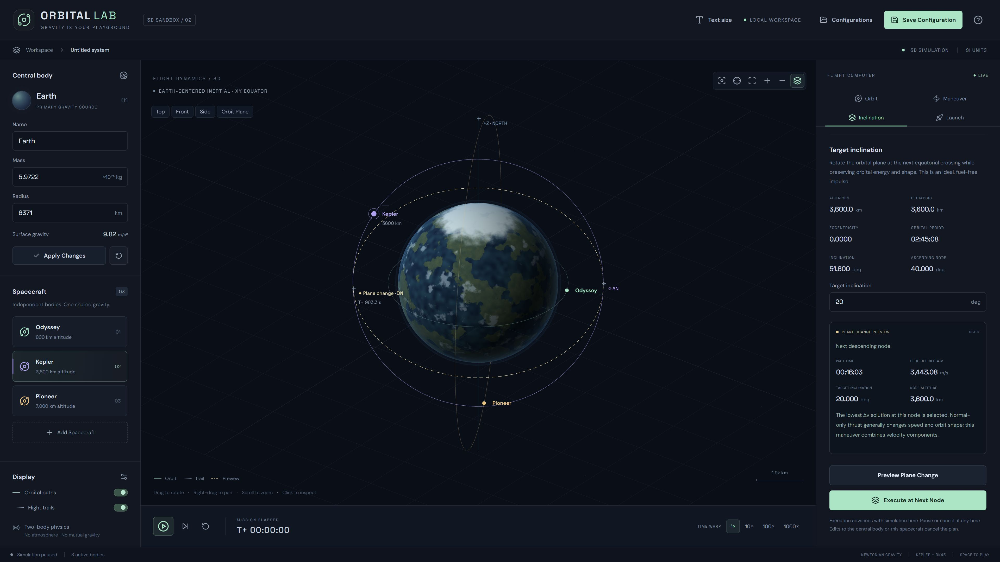

# Orbital Lab

**English** | [简体中文](README.zh-CN.md)

A three-dimensional orbital mechanics sandbox with a single configurable central body. Create inclined circular orbits, preview impulsive and finite maneuvers, schedule shape-preserving inclination changes at equatorial nodes, and launch a single-stage rocket from any surface location. The interface remains in English; documentation is available in English and Simplified Chinese.



## Run locally

Use **Node.js 22.12+ or Node.js 24+**. The project has been verified with Node.js 24. Run these commands from the project root:

```powershell
npm install
npm run dev
```

Open the [local address](http://127.0.0.1:5173) printed in the terminal. The server listens only on `127.0.0.1`.

If Windows PowerShell blocks `npm.ps1`, replace `npm` with `npm.cmd` in these commands. There is no need to change the system execution policy.

To build and run the production version:

```powershell
npm run build
npm start
```

The production build still requires the local server started by `npm start` to read and write configuration files. Do not open `dist/index.html` directly. To use a different port in PowerShell, set `$env:PORT = "5180"` before starting the server.

Run the tests with:

```powershell
npm test
```

Storage tests use temporary directories and do not modify your configuration file. Once dependencies are installed, the application runs offline: fonts, icons, and planet visuals are provided locally.

## Using the sandbox

### Central body and spacecraft

- Set the name, mass, and radius under `Central body`, then click `Apply Changes`. Mass is entered in `×10²⁴ kg`; radius is entered in kilometers.
- Applying changes pauses the simulation, preserves each object's absolute position and velocity, and recalculates its orbit. Objects inside the new surface are marked as impacted.
- `Use Earth preset` restores Earth's parameters in the editor. Click `Apply Changes` to apply them.
- `Add Spacecraft` creates an independent orbiting body. Select it in the list or scene. Use the cross in the upper-right corner of its list entry to remove it.
- In the `Orbit` panel, `Orbital altitude` and `Circular velocity` update each other using the circular-orbit equation. All altitudes are measured above the central body's surface.
- Set `Inclination` from 0° to 180°, `Ascending node longitude` from 0° to 360°, and `Initial orbital phase` from 0° to 360°. The phase is an argument of latitude, measured in the orbit plane from its ascending-node reference direction along motion. At 0° or 180° inclination, the editor's node angle still defines a reproducible orientation, although the physical ascending node is undefined.
- 0° is an equatorial prograde orbit, 90° is polar, and angles greater than 90° are retrograde. Inclination replaces the old clockwise/counterclockwise setting, which depended on viewing direction.
- `Apply Circular Orbit` rebuilds the selected spacecraft and pauses. Altitude-only edits preserve its **live orbital plane and phase**, including after a plane change. Editing the plane or phase rebuilds position from the editor setup. This operation also updates the initial configuration used for saving and resetting; it is not a physical maneuver.
- Telemetry reports inclination and ascending-node longitude, with `N/A` when the orbital plane or node is undefined. The next equatorial crossing is shown when one exists.
- Live telemetry is separate from the editor. After a maneuver produces an elliptical orbit, the editor still describes the initial circular orbit, while telemetry shows the actual flight state.

Drag to rotate the view, right-drag (or modified left-drag) to pan, scroll to zoom, and click a visible spacecraft to select it. Controls let you follow the selected spacecraft, center on the planet, fit all spacecraft, zoom, or toggle the reference grid and north axis. `Top`, `Front`, `Side`, and `Orbit Plane` set the camera without changing physical states.

The frame is right-handed: **XY is the fixed equatorial plane, +Z is north, and +X is the longitude reference**. AN and DN mark ascending and descending equatorial crossings. Orbits, markers, and labels behind the planet are occluded, so use the spacecraft list to select a hidden craft. The bottom controls let you play, pause, advance by one second, or restore the current configuration's initial state. Press Space to play or pause when you are not interacting with an input or button.

`1× / 10× / 100× / 1000×` select the requested time scale. Under heavy load, the physics engine reduces the effective simulation speed and reports it in the status bar rather than skipping impact or engine-cutoff events.

### Text size and high-resolution displays

Click `Text size` in the header (the text icon on smaller screens) to choose an interface text size from **100% to 250%**. Changes apply immediately to text, controls, and panel spacing. **200%** is a useful starting point for a 4K display; choose the setting that suits your monitor and operating-system scaling.

The layout adapts to the available space at the selected size. Your choice is remembered in this browser, including after a reload. It does not change the simulation or saved celestial configurations. Use `Reset to 100%` to restore the default size.

### Maneuvers

Enter a delta-v and direction in the `Maneuver` panel. Changing parameters pauses the simulation and automatically generates a dashed trajectory preview. Execution is available once the preview is ready.

- `Instant impulse`: changes velocity immediately at the current position.
- `Finite burn`: applies a constant acceleration magnitude of `Δv / duration` for the specified duration. This idealized maneuver does not consume fuel. Use `Stop Engine` to end it early.
- `Prograde / Retrograde`: accelerates along or against the current velocity. At zero velocity, a deterministic local horizontal tangent is used, and a notice is displayed (reference +Z, or +X near the poles).
- `Radial out / Radial in`: accelerates away from or toward the center.
- `Normal / Anti-normal`: accelerates along or against the orbital angular-momentum vector `r × v`. A normal-only impulse changes the orbit plane and generally also changes speed, energy, and orbit shape.
- `Custom 3D direction`: the in-plane angle is 0° along the transverse direction of motion and 90° radially outward. The out-of-plane angle is 0° in the current plane, +90° normal, and −90° anti-normal. Unlike the old planar custom angle, the transverse reference follows retrograde motion.
- The local basis is `R = r/|r|`, `N = (r×v)/|r×v|`, `T = N×R`. Normal and custom directions are unavailable when angular momentum is too small to define a plane. Prograde and radial thrust remain available.

During a finite burn, the local direction is recalculated at every integration stage. The requested delta-v is the time integral of the acceleration magnitude. It differs from the change in the velocity vector over the burn, which also includes gravity. Both values are displayed after the maneuver.

Pausing freezes simulation time; it does not cancel an active engine. Resetting the scene clears live maneuvers and temporary launch vehicles.

### Target inclination at a node

Open `Inclination`, enter a target from 0° to 180°, and inspect the automatically generated preview. It includes the next node, wait time, required delta-v, node altitude, and the resulting orbit.

`Execute at Next Node` arms one ideal, fuel-free **instantaneous** plane change and starts simulation time. The scene displays a countdown and `Cancel Plane Change`. Play/pause and time warp work normally; a single step can cross and execute the event. Cancellation pauses the simulation. Only one target plane change can be armed at a time.

At the node, the solver preserves radial velocity and transverse speed while rotating the orbital normal to the target inclination. It selects the nearer of the two possible normals, keeping orbital energy, eccentricity, periapsis, and apoapsis unchanged within numerical tolerance. For a circular orbit, the required delta-v is `2v sin(Δθ/2)`. This is a combined velocity-vector change rather than simply adding normal speed. Target inclination does not independently target ascending-node longitude.

An equatorial orbit uses its current position as the rotation hinge and executes immediately. Planning is unavailable during a burn, for an undefined plane, when there is no future node on an open trajectory, or when impact occurs before that node. A reset, configuration load, central-body edit, or physical edit/removal of the target spacecraft cancels the task. Preview epoch and state revision are checked again before arming. The node event shares the simulation advancement path with engine and surface events, including at high time warp.

Use manual finite burns for sustained plane changes; automatic finite-duration targeting and multi-burn optimization are outside this release.

### Surface launches

Configure the vehicle in the `Launch` panel:

| Field                 | Meaning                                                                   |
| --------------------- | ------------------------------------------------------------------------- |
| Launch latitude / longitude | Surface location in degrees: latitude −90°…90°, longitude −180°…180° |
| Launch azimuth | Bearing clockwise from local north: 0° north, 90° east, 180° south |
| Dry mass              | Vehicle mass including payload but excluding propellant, in kg            |
| Propellant            | Initial propellant mass, in kg                                            |
| Specific impulse      | Constant specific impulse, in seconds                                     |
| Thrust                | Constant thrust, in kN                                                    |
| Engine work time      | Planned engine operating time, in seconds                                 |
| Turn start / Turn end | Times after ignition when the pitch turn starts and ends, in seconds      |
| Final pitch           | Final angle above the local horizon: 90° is vertical and 0° is horizontal |

The rocket starts at rest at the selected surface location on the non-rotating body. Default latitude 0°, longitude 90°, and azimuth 90° reproduce the original equatorial eastward launch. It points vertically upward until the turn starts, changes pitch linearly during the turn, then holds final pitch and the specified local compass bearing. Heading uses local east/north/up directions at every integration stage. At an exact polar launch site, longitude and azimuth define an initial meridian plane; guidance keeps that plane to avoid the geographic-bearing singularity. The surface supports the rocket until outward thrust is sufficient for liftoff. This is a pitch-and-heading program, not automatic targeting of an orbit or inclination.

Predictions update automatically when parameters change. The engine stops at the planned time, when propellant is exhausted, or on surface impact. The prediction shows altitude, speed, remaining propellant, and the resulting orbit's periapsis, apoapsis, inclination, and ascending-node longitude at engine cutoff. Live flight telemetry shows engine time and propellant; after cutoff, the recorded actual cutoff orbit is shown separately from the vehicle's current orbit.

The default preset reaches an elliptical orbit: propellant runs out after approximately 264.78 seconds, at an altitude of 128.39 km, with a periapsis of 113.79 km and an apoapsis of 4,663.28 km. Displayed values are rounded. After cutoff, switch to `Maneuver` to adjust the orbit further.

**A high apoapsis alone does not mean a stable orbit.** The periapsis of a closed orbit must clear the surface. `Surface intersection` indicates a future ground intersection. `Escape trajectory` indicates an open trajectory with no finite apoapsis or orbital period. This release does not provide automatic second burns or circularization.

## Saving local configurations

Click `Save Configuration` in the header to save. The first save asks for a name. Saving an already loaded configuration asks you to confirm the overwrite. Open `Configurations` to access the library:

- `Save As`: saves a new named configuration.
- `Load Configuration`: replaces the scene, clears trails and maneuvers, rebuilds the initial circular orbits, and leaves the simulation paused.
- Delete icon: removes the configuration from the file after confirmation. The current scene remains open.
- `Restore Default Example`: restores Earth and the three default spacecraft.

If applied configuration changes have not been saved, loading another configuration or restoring the default example prompts you before discarding them. Changes typed into editor fields but not yet applied are not saved.

Configurations are stored in **`celestial-configs.json`** in the project root, beside `package.json`. The file is created on the first save. There are no user accounts or separate user libraries. The file contains:

```text
version: 2
configurations:
  - id / name / updatedAt
  - central: name / mass / radius
  - orbiters[]: id / name / color / altitude / phase / inclination / ascendingNode
```

Mass, radius, and altitude use SI units in the file. Initial orbital phase, inclination, and ascending-node longitude are stored in degrees. `updatedAt` is a UTC ISO timestamp; the interface displays it in the browser's local time zone.

Configurations **do not save** simulation time, live positions and velocities, maneuver results, pending node tasks, temporary launch vehicles, launch parameters, or remaining fuel. Display preferences are stored separately in localStorage.

The server validates configuration data, serializes write requests, and atomically replaces the file through a temporary file in the same directory. A missing file produces an empty library. A damaged file or unsupported format produces an error and preserves the original file without overwriting it. You can copy the JSON file for backup or transfer. Avoid editing it while the application is writing, or running multiple server processes against the same file.

**Version 1 compatibility:** legacy files are converted in memory without modifying the original. Counterclockwise orbits become 0° inclination; clockwise orbits become 180° with reversed phase. Initial position and velocity remain unchanged. The first successful write (including deletion) creates `celestial-configs.json.v1.bak` containing the original version 1 bytes, then atomically writes version 2. An existing different backup or a backup write failure prevents replacing the original file. Subsequent version 2 writes leave the backup unchanged. Older application versions cannot read version 2; restore the backup manually if reverting.

The following endpoints are intended for the local, same-origin application:

| Endpoint                         | Behavior                                                                                                                            |
| -------------------------------- | ----------------------------------------------------------------------------------------------------------------------------------- |
| `GET /api/configurations`        | Returns `{version: 2, configurations: [...]}`                                                                                       |
| `PUT /api/configurations/:id`    | Accepts `{name, central, orbiters}`, creates or replaces the configuration, and returns the record with its ID and update timestamp |
| `DELETE /api/configurations/:id` | Deletes the specified configuration and returns HTTP 204 on success                                                                 |

## Physics model and numerical methods

- The central body is fixed, non-rotating, and spherically symmetric. Orbiting objects are test particles and do not interact with one another.
- `μ = GM`, gravitational acceleration is `a = −μr / |r|³`, and circular speed is `v = √(μ / (R+h))`.
- Unpowered flight uses universal-variable Kepler propagation for elliptical, near-parabolic, and hyperbolic trajectories.
- Powered flight uses adaptive Dormand–Prince RK45 integration, with an absolute position tolerance of 1 mm, absolute velocity and fuel tolerances of `10⁻⁷`, and a relative tolerance of `10⁻¹⁰`. Numerical tolerances are not a guarantee of real-world prediction accuracy.
- Propellant mass flow is `ṁ = F / (Isp × g₀)`, where `g₀ = 9.80665 m/s²`. Dry mass remains constant while propellant mass decreases.
- Step sizes are limited by local dynamical time and surface proximity. Impacts are located by bisection; timed cutoff, propellant exhaustion, and planned node maneuvers are aligned with their event times. Future equatorial nodes use conic time-of-flight formulas refined against the same Kepler propagator used for playback.
- Instantaneous orbital elements are derived from the state vectors. During powered flight, the displayed orbit is the Keplerian trajectory that would follow an immediate engine shutdown; it continues changing while thrust is applied.
- Predictions and playback share the same physics core. Tests cover conservation over multiple orbital periods, different time partitions, the ideal rocket equation, impacts, escape, engine events, arbitrary and retrograde orbit planes, three-dimensional burn directions, node targeting and cancellation, version 1 migration, polar launch guidance, and 50 independent bodies. Standard regression targets are relative physical error below `10⁻⁵` and target inclination error below `10⁻⁵` degrees for non-degenerate scenarios.

References: [NASA: Specific Impulse](https://www1.grc.nasa.gov/beginners-guide-to-aeronautics/specific-impulse/), [NASA: Ideal Rocket Equation](https://www1.grc.nasa.gov/beginners-guide-to-aeronautics/ideal-rocket-equation/), and [JPL: Orbital Elements from State Vectors](https://naif.jpl.nasa.gov/pub/naif/toolkit_docs/C/cspice/oscelt_c.html).

## Project structure and extension points

```text
src/types.ts                     State, configuration, maneuver, and Worker message types
src/defaults.ts                  Default scene and engine parameters
src/physics/vector.ts            Three-dimensional vector operations
src/physics/frames.ts            Reference frames, plane orientation, and launch-site geometry
src/physics/planeChange.ts       Equatorial-node location and target-inclination solver
src/physics/timeline.ts          Event-aligned advancement and scheduled maneuver lifecycle
src/physics/core.ts              UI-independent physics and orbital mechanics
src/physics/simulation.worker.ts Simulation clock, trajectory prediction, and cancellation
src/useSimulation.ts             Worker communication
src/components/Universe.tsx      Three.js rendering and view controls
src/components/Fields.tsx        Parameter inputs and telemetry components
src/App.tsx                      English interface and user interactions
server/store.ts                  JSON validation and atomic storage
server/app.ts                    Local HTTP API
server/index.ts                  Development and production server entry point
tests/                          Physics, storage, and API tests
```

Positions, velocities, and accelerations are double-precision `[x, y, z]` vectors in meters, kilograms, and seconds. Coordinates are scaled only in rendering. Physics remains independent of React and Three.js. Worker commands and shared types separate preview, scheduling, execution, and persistence; rendering reuses line buffers and marker objects across telemetry updates. Camera controls are Three.js `OrbitControls` with +Z up and an orthographic projection.

The dynamics are implemented locally in TypeScript; Three.js provides rendering, not orbital physics. The Kepler and RK45 propagators are shared by prediction and actual flight. Future extensions can add attitude guidance or central-body rotation through the launch direction model, or replace propagation for perturbations while keeping the state-vector interface. A general rigid-body game engine is not needed for the present point-mass model.

This release does not include atmospheric drag, multi-body gravity, collisions between orbiting objects, rotating or oblate central bodies, J₂ perturbations, rocket staging, automatic insertion/circularization, or full simulation checkpoints. The browser must support WebGL and Web Workers.

DM Sans and Space Grotesk are included locally; their licenses are in `public/fonts/*-OFL.txt`. Icons are provided by Lucide.
