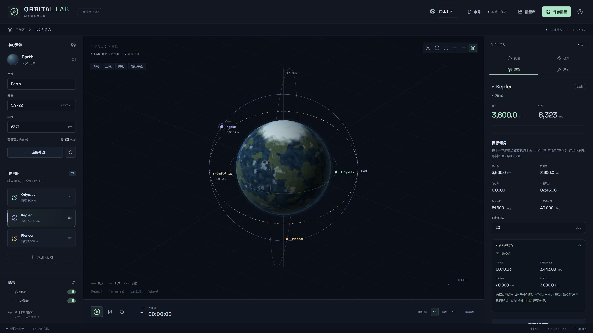

# Orbital Lab（轨道实验室）

[English](README.md) | **简体中文**

一个三维轨道力学沙盒，包含一个可配置的中心天体。你可以创建具有不同倾角的圆轨道，预览和执行瞬时机动与持续机动，在赤道交点安排保持轨道形状的倾角变更，以及从任意地面位置发射单级火箭。应用界面支持英文与简体中文切换，文档也提供这两个版本。



## 本地运行

使用 **Node.js 22.12+ 或 Node.js 24+**。项目已在 Node.js 24 环境验证。在项目根目录执行：

```powershell
npm install
npm run dev
```

打开终端输出的[本地地址](http://127.0.0.1:5173)。服务仅监听 `127.0.0.1`。

如果 Windows PowerShell 阻止运行 `npm.ps1`，将命令中的 `npm` 替换为 `npm.cmd` 即可，无需修改系统执行策略。

构建并运行生产版本：

```powershell
npm run build
npm start
```

生产版本仍需通过 `npm start` 启动本地服务，才能读写配置文件。不要直接打开 `dist/index.html`。如需更换端口，可在 PowerShell 中先设置 `$env:PORT = "5180"`，再启动服务。

运行测试：

```powershell
npm test
```

存储测试使用临时目录，不会修改你的配置文件。安装依赖后，应用可以离线运行：字体、图标和行星视觉效果均由本地提供。

## 后台启动、停止与重启

三个脚本位于项目根目录，与 `package.json` 同级。首次在目标操作系统上准备生产版：

```text
npm ci
npm run build
```

Windows PowerShell 如果阻止 `npm.ps1`，请使用 `npm.cmd`。需安装全部依赖，包括开发依赖，因为服务端需要本地 `tsx` 加载器。Linux 应在 Linux 上安装依赖，不要复制 Windows 的 `node_modules`。

Windows 命令提示符：

```bat
orbital-lab.cmd start
orbital-lab.cmd stop
orbital-lab.cmd restart
```

PowerShell 中使用 `.\orbital-lab.cmd start`，停止和重启分别替换为 `stop`、`restart`。CMD 入口调用兼容 Windows PowerShell 5.1+ 的 `orbital-lab.ps1`，不加载用户配置；执行策略绕过仅作用于该次子进程，不修改系统策略。服务在后台运行，不弹出额外控制台。

Linux 需要 Bash 4+、`flock`、`nohup` 和 `/proc`：

```bash
bash ./orbital-lab.sh start
bash ./orbital-lab.sh stop
bash ./orbital-lab.sh restart
```

脚本按自身位置定位项目，可从其他工作目录通过绝对路径调用，支持空格及中文路径。需要 Node.js 22.x 中的 22.12+ 或 Node.js 24+、已安装的依赖与生产构建。脚本不会安装依赖、重新构建、打开浏览器或注册系统服务。源码更新后需手动执行 `npm run build`。

默认地址为 `http://127.0.0.1:5173`，仍仅监听本机。启动或重启前可通过 `PORT` 指定端口：

```powershell
$env:PORT = "5180"
.\orbital-lab.cmd start
```

```bash
PORT=5180 bash ./orbital-lab.sh start
```

关闭控制终端后，服务继续运行。每个项目目录管理一个实例；重复 `start` 会报告已有实例的地址。`stop` 按进程记录停止服务，不受当前 `PORT` 影响，未运行时也会成功返回。`restart` 先停止，停止成功后才重新启动，并读取新的 `app-config.json` 和本次端口设置。

日志追加写入 `.runtime/stdout-windows.log`、`.runtime/stderr-windows.log`，Linux 对应为 `*-linux.log`。进程记录和控制锁也保存在此已忽略的目录。部署时不要复制 `.runtime`，服务运行时不要删除它。脚本只管理自己启动的实例，不接管通过 npm 手动启动的服务。

启动最多等待 30 秒，通过 `/api/settings` 和所启动进程的身份确认服务就绪。依赖或构建缺失、设置文件或端口无效、端口被占用、启动失败时，返回非零退出码并给出诊断；启动失败会提示日志位置。已有进程不健康时不会启动第二个实例。并发控制命令会被拒绝，等待前一个命令完成后重试。

停止前校验 PID、进程启动时间、Node 可执行文件和完整项目启动命令，不会仅凭端口结束进程。Linux 先发送 `SIGTERM`，等待 10 秒后，仅对身份仍匹配的进程发送 `SIGKILL`；Windows 直接停止身份验证通过的 Node 进程。PID 被复用或身份无法确认时，拒绝停止与重启；请先检查记录和实际进程，再决定是否手动删除记录。已退出进程的记录可自动清理。移动或重命名部署目录之前，应先停止服务。

集成测试使用临时项目副本和独立配置执行真实启停。已验证 Windows PowerShell 5.1 和 Rocky Linux 9（WSL、Linux 原生 Node.js 24.18.0 及依赖），覆盖空格与中文路径、并发操作、端口冲突、失效进程身份以及 demo 模式重启。

## 使用沙盒

### 中心天体与飞行器

- 在 `Central body` 中设置名称、质量和半径，然后点击 `Apply Changes`。质量输入单位为 `×10²⁴ kg`，半径输入单位为千米。
- 应用修改会暂停模拟，保留各物体的绝对位置和速度，并重新计算轨道。位于新表面以内的物体会被标记为撞击。
- `Use Earth preset` 将地球参数填入编辑器；点击 `Apply Changes` 后才会生效。
- `Add Spacecraft` 新增一个独立的环绕物体。可在列表或场景中选择它，点击其列表项右上角的叉号可将其移除。
- 在 `Orbit` 面板中，`Orbital altitude`（轨道高度）与 `Circular velocity`（圆轨道速度）按照圆轨道公式双向联动。所有高度均从中心天体表面计算。
- `Inclination`（倾角）范围为 0°–180°，`Ascending node longitude`（升交点经度）和 `Initial orbital phase`（初始轨道相位）范围均为 0°–360°。这里的相位是纬度幅角：在轨道平面内，从升交点参考方向沿运动方向量取。倾角为 0° 或 180° 时，物理上的升交点没有定义，但编辑器中的节点角仍可用于确定可复现的初始方位。
- 0° 对应赤道顺行轨道，90° 对应极轨，超过 90° 对应逆行轨道。倾角设置取代了旧版依赖观察方向的顺时针／逆时针选择。
- `Apply Circular Orbit` 重建所选飞行器的圆轨道并暂停模拟。仅修改高度时，会保留它的**实时轨道平面和相位**，包括变轨后的平面；修改平面或相位时，则按照编辑器设置重建位置。此操作还会更新保存和重置使用的初始配置，属于编辑器重建操作，不是物理机动。
- 遥测显示倾角和升交点经度；轨道平面或节点没有定义时显示 `N/A`。存在下一次赤道交点时，也会显示其到达时间。
- 实时遥测与编辑器设置相互独立。机动使轨道变为椭圆后，编辑器仍描述初始圆轨道，遥测则显示实际飞行状态。

拖动鼠标可旋转视图，右键拖动或按住修饰键后左键拖动可平移，滚轮可缩放，点击可见飞行器可选中它。场景控件支持跟随所选飞行器、居中行星、将所有飞行器纳入视野、缩放，以及切换参考网格和北极轴。`Top`、`Front`、`Side` 和 `Orbit Plane` 分别切换到顶视、正视、侧视和轨道平面视角，不改变物理状态。

系统采用右手坐标系：**XY 为固定赤道平面，+Z 指向北极，+X 为经度参考方向**。AN 和 DN 分别标记升交点和降交点。位于行星背面的轨道、标记和标签会被遮挡，可通过飞行器列表选择被遮挡的物体。底部控件支持播放、暂停、推进一秒，以及恢复当前配置的初始状态。未在输入框或按钮中操作时，可按空格键切换播放／暂停。

`1× / 10× / 100× / 1000×` 用于选择时间倍率。负载较高时，物理内核会降低实际模拟速度，并在状态栏报告，而不会跳过撞击或发动机熄火事件。

### 界面语言

使用顶部语言选择器切换 `English` 和 `简体中文`。首次访问默认使用英文，不自动跟随浏览器语言。选择保存在 `localStorage` 的 `orbital-lab.language` 中；浏览器禁用存储时，仍可在当前会话中切换。对话框标题栏也提供语言选择器，因此可以在不丢失草稿的情况下翻译已打开的对话框。

切换会更新字段名称、帮助、通知、无障碍标签、场景标注和页面标题，并保留模拟时间、播放状态、发动机、待执行机动、相机位置和编辑器草稿。用户输入的名称与预设专名保持原文。显示的数值和日期随语言格式化，时间戳仍按浏览器时区显示；数值输入继续使用无分组的小数点解析规则，任务时间仍为持续时间。本文中的英文控件名对应英文界面，中文界面显示相应译名。

**SI 单位名称、符号和组合表达不翻译。** `m`、`km`、`kg`、`s`、`kN`、`m/s`、`m/s²`、`×10²⁴ kg` 在两种语言中保持一致，`°` 和 `deg` 也保持原样。切换语言不会换算物理数值或单位制。单位表示独立定义在 `src/i18n/units.ts` 中，通过参数传入消息。

英文资源随主程序发布，中文资源按需从本地构建文件加载，不使用外部翻译服务。缺失或为空的条目、缺失的命名空间均回退英文；整个语言包缺失、为空或加载失败时，实际界面语言、选择器和保存的偏好都会切回英文。不受支持的偏好（包括预留的法语）同样使用英文。本版不处理从右往左排版。

#### 新增语言

1. 在 `src/i18n/locales/<code>/` 下新增 `common.json`、`sandbox.json`、`help.json` 和 `errors.json`，沿用英文语义键和相同的插值参数。整句保持在同一条翻译中，复数使用基础键并传入 `count`。
2. 在 `src/i18n/languages.ts` 注册语言代码、原生名称、`formatLocale`、四个本地资源文件的加载器，并设置 `enabled: true`。法语（`fr`、`Français`、`fr-FR`）已预留未启用的注册项，启用前须补齐资源与加载器。本版不包含法语翻译文件，也不显示可选的法语入口。
3. 运行翻译完整性测试；若正式启用法语，同时更新预留语言的测试断言，然后重新构建。业务组件无需增加语言分支。其他语言的小数输入规则应在公共输入层扩展，不要分散到各面板。

英文资源定义翻译键类型。`npm test` 检查键覆盖、插值参数、复数、回退、存储失败、稳定错误代码和单位一致性。通知与对话框保存消息引用及参数，而不是已翻译的字符串。物理内核与本地服务产生语言无关的代码，不加载翻译资源。天体配置继续使用版本 2，保存初始状态的范围不变。

### 字号与高分辨率显示器

点击顶部的 `Text size`（小屏幕上显示为文字图标），可在 **100%–250%** 之间选择界面字号。文字、控件和面板间距会立即同步调整。4K 显示器可以从 **200%** 开始尝试，再根据显示器与操作系统缩放设置调整。

布局会根据所选字号和可用空间自动适配。选择会保存在当前浏览器中，刷新后仍然生效，不影响模拟状态或已保存的天体配置。点击 `Reset to 100%` 可恢复默认字号。

### 手动机动

在 `Maneuver` 面板输入速度增量和方向。修改参数会暂停模拟，并自动生成虚线轨迹预览；预览就绪后可以执行。

- `Instant impulse`：在当前位置立即改变速度。
- `Finite burn`：在指定时长内施加大小恒定的加速度 `Δv / duration`。这是不消耗燃料的理想模型，点击 `Stop Engine` 可提前终止。
- `Prograde / Retrograde`：沿当前速度方向或其反方向加速。速度为零时，使用确定性的当地水平切向作为回退，并显示提示；参考轴通常为 +Z，靠近极点时使用 +X。
- `Radial out / Radial in`：沿远离中心或指向中心的径向加速。
- `Normal / Anti-normal`：沿轨道角动量向量 `r × v` 或其反方向加速。单独施加法向速度增量会改变轨道平面，通常也会改变速度大小、轨道能量和形状。
- `Custom 3D direction`：平面内角度以沿运动方向的横向为 0°、径向向外为 90°；出平面角以当前轨道平面为 0°、法向为 +90°、反法向为 −90°。与旧版二维自定义角不同，横向参考方向会随逆行运动改变。
- 当地基底为 `R = r/|r|`、`N = (r×v)/|r×v|`、`T = N×R`。角动量过小、无法定义轨道平面时，法向和自定义方向不可用；顺行和径向推力仍然可用。

持续机动会在每个积分阶段重新计算当地方向。输入的速度增量是加速度大小对时间的积分，与整个机动期间的实际速度矢量变化不同，后者还包含重力的影响。机动结束后会同时显示这两个数值。

暂停只会冻结模拟时间，不会取消正在工作的发动机。重置场景会清除实时机动和临时发射飞行器。

### 在节点调整到目标倾角

打开 `Inclination` 面板，输入 0°–180° 的目标倾角，查看自动生成的预览。预览包含下一个节点、等待时间、所需速度增量、节点高度和变轨后的轨道。

点击 `Execute at Next Node`，即可安排一次理想、不消耗燃料的**瞬时**轨道平面变更，并开始推进模拟时间。场景会显示倒计时和 `Cancel Plane Change` 按钮。播放／暂停和时间倍率照常工作，单步推进也可以跨越节点并执行机动。取消任务会暂停模拟。整个场景同时最多安排一个目标倾角任务。

求解器在节点保留径向速度与横向速度大小，将轨道法向旋转到目标倾角；存在两种可能法向时，选择旋转角较小的一种。在数值容差内，轨道能量、偏心率、近地点高度和远地点高度保持不变。圆轨道的所需速度增量为 `2v sin(Δθ/2)`。这是组合速度矢量变化，不是简单叠加法向速度。目标倾角功能不单独指定升交点经度。

对于赤道轨道，使用当前位置作为平面旋转支点，立即执行。发动机工作中、轨道平面未定义、开放轨道不存在未来节点，或飞行器会在节点前撞击地面时，不能安排任务。重置、加载配置、修改中心天体，或对目标飞行器进行物理状态修改／移除，都会取消任务。安排任务前会再次检查预览时刻与状态版本。节点机动、发动机事件和表面撞击使用相同的模拟推进流程，高时间倍率下也会对齐事件时刻。

持续改变轨道平面可以使用手动持续机动。本版不提供自动持续机动目标求解或多次点火优化。

### 地面发射

在 `Launch` 面板设置飞行器：

| 英文字段 | 含义 |
| --- | --- |
| Launch latitude / longitude | 发射位置，单位为度；纬度 −90°–90°，经度 −180°–180° |
| Launch azimuth | 从当地北向顺时针量取的方位角：0° 向北、90° 向东、180° 向南 |
| Dry mass | 干质量，包含载荷但不含推进剂，单位为 kg |
| Propellant | 初始推进剂质量，单位为 kg |
| Specific impulse | 恒定比冲，单位为秒 |
| Thrust | 恒定推力，单位为 kN |
| Engine work time | 计划的发动机工作时间，单位为秒 |
| Turn start / Turn end | 点火后开始和结束俯仰转弯的时间，单位为秒 |
| Final pitch | 相对当地水平面的最终俯仰角：90° 垂直向上，0° 水平 |

火箭从不自转天体上所选的地面位置静止起飞。默认纬度为 0°、经度为 90°、方位角为 90°，与旧版赤道向东发射一致。转弯开始前保持垂直向上，在转弯期间线性改变俯仰角，之后保持最终俯仰角与指定的当地航向。每个积分阶段都会根据当地东、北、天方向计算推力方向。若发射点恰好位于极点，经度与方位角会定义初始子午面，制导过程保持该平面，以避免地理航向的奇异性。向外推力足以起飞之前，地面会为火箭提供支撑。这是俯仰与航向程序，不会自动求解目标轨道或倾角。

修改参数后会自动更新预测。发动机会在达到工作时间、推进剂耗尽或撞击地面时停止。预测显示熄火时的高度、速度、剩余推进剂，以及熄火后轨道的近地点、远地点、倾角和升交点经度。实时遥测显示发动机工作时间与推进剂余量；熄火后，记录的实际熄火轨道会与飞行器当前轨道分开显示。

默认预设可进入椭圆轨道：推进剂约在 264.78 秒耗尽，熄火高度约 128.39 km，近地点高度约 113.79 km，远地点高度约 4,663.28 km。显示数值经过舍入。熄火后可切换到 `Maneuver` 继续调整轨道。

**远地点很高并不等于已经稳定入轨。** 闭合轨道的近地点必须高于地表。`Surface intersection` 表示未来会与地面相交；`Escape trajectory` 表示开放轨道，没有有限的远地点或轨道周期。本版不提供自动二次点火或圆化。

## 保存本地配置

点击顶部的 `Save Configuration` 保存。首次保存需要输入名称，保存已加载的配置时会要求确认覆盖。打开 `Configurations` 进入配置库：

- `Save As`：以新名称另存一组配置。
- `Load Configuration`：替换当前场景，清除轨迹与机动，重建初始圆轨道，并保持暂停。
- 删除图标：确认后从文件中删除指定配置，当前场景仍保持打开。
- `Restore Default Example`：恢复地球与三个默认飞行器。

已应用的配置修改尚未保存时，加载其他配置或恢复默认示例会先要求确认。只输入到编辑器、尚未应用的修改不会保存。

配置存放于项目根目录的 **`celestial-configs.json`**，与 `package.json` 同级，首次保存时创建。不包含用户账号，也不区分不同用户的配置库。文件结构如下：

```text
version: 2
configurations:
  - id / name / updatedAt
  - central: name / mass / radius
  - orbiters[]: id / name / color / altitude / phase / inclination / ascendingNode
```

文件中的质量、半径和高度使用国际单位制，初始轨道相位、倾角和升交点经度使用度。`updatedAt` 是 UTC ISO 时间戳，界面按浏览器所在时区显示。

配置**不保存**模拟时间、实时位置与速度、机动结果、待执行的节点任务、临时发射飞行器、发射参数或剩余燃料。显示偏好单独保存在 localStorage 中。

服务端会校验配置数据，串行处理写入请求，并通过同目录临时文件原子替换配置文件。文件不存在时返回空配置库；文件损坏或格式不受支持时，显示错误并保留原文件，不覆盖。可以复制 JSON 文件用于备份或迁移。避免在应用写入期间手动编辑文件，也不要让多个服务进程同时写入同一个文件。

**版本 1 兼容：** 读取旧文件时，仅在内存中转换，不修改原文件。逆时针轨道转换为 0° 倾角；顺时针轨道转换为 180° 倾角，并反转相位，保证初始位置和速度不变。首次成功写入（包括删除配置）之前，会将版本 1 原始文件内容备份到 `celestial-configs.json.v1.bak`，随后原子写入版本 2。如果备份已存在但内容不同，或备份无法写入，则不会替换原文件。后续版本 2 写入不会修改备份。旧版应用无法读取版本 2，回退应用时需手动恢复备份。

以下接口供本地同源应用使用：

| 接口 | 行为 |
| --- | --- |
| `GET /api/configurations` | 返回 `{version: 2, configurations: [...]}` |
| `PUT /api/configurations/:id` | 接收 `{name, central, orbiters}`，新增或替换配置，并返回包含 ID 和更新时间的记录 |
| `DELETE /api/configurations/:id` | 删除指定配置，成功后返回 HTTP 204 |

错误响应保留英文诊断字段 `error`，并增加稳定的 `code` 和可选 `params`，由前端翻译代码。Worker 错误使用相同的代码与参数约定。熄火原因采用稳定枚举，仅在展示时翻译。未知错误使用通用本地化提示，诊断信息可以继续保持英文。

## 演示模式（配置库只读）

编辑项目根目录、与 `package.json` 同级的 **`app-config.json`**：

```json
{
  "demoMode": true
}
```

随源码提供的默认值为 `false`。修改后重启 `npm run dev` 或 `npm start` 即可生效，无需重新构建；不提供环境变量覆盖或界面开关。文件不存在或省略 `demoMode` 时默认为普通模式。JSON 无效、存在未知设置、值不是布尔类型或文件读取失败时，服务会输出诊断并停止启动，保留原文件。

演示模式下，**保存配置**、**另存为**、覆盖和删除均被禁用；仍可查看、刷新和加载已有配置。模拟、编辑、发射和变轨功能保持可用，修改只保留在当前会话中。加载其他系统或离开页面时，沿用现有的未保存修改确认。

`GET /api/settings` 返回 `{ "demoMode": boolean }` 并禁止缓存。服务端在访问存储层之前，对配置的 `PUT` 和 `DELETE` 请求返回 HTTP 403，错误代码为 `DEMO_MODE_READ_ONLY`；绕过界面按钮也无法修改配置库。读取旧版配置不会触发文件迁移或备份。

读取应用设置期间，配置写入暂时禁用。读取失败时，界面显示本地化错误和**重试读取设置**按钮，模拟功能仍可使用。演示模式标记和禁用原因会随英文／简体中文界面切换。

## 物理模型与数值方法

- 中心天体固定、不自转且球对称。环绕物体视为测试粒子，彼此之间不相互作用。
- `μ = GM`，引力加速度为 `a = −μr / |r|³`，圆轨道速度为 `v = √(μ / (R+h))`。
- 无推力飞行使用通用变量开普勒传播，支持椭圆、近抛物线和双曲线轨道。
- 有推力飞行使用自适应 Dormand–Prince RK45 积分。位置绝对容差为 1 mm，速度和燃料绝对容差为 `10⁻⁷`，相对容差为 `10⁻¹⁰`。数值容差不代表现实世界中的预测精度保证。
- 推进剂质量流率为 `ṁ = F / (Isp × g₀)`，其中 `g₀ = 9.80665 m/s²`。干质量不变，推进剂质量随时间减少。
- 积分步长受当地动力学时间尺度与地表距离约束。撞击时刻通过二分法定位；定时熄火、燃料耗尽和计划中的节点机动均对齐其事件时刻。未来赤道交点的到达时间使用圆锥曲线飞行时间公式求解，再用与实际运行相同的开普勒传播器修正。
- 瞬时轨道要素由状态矢量推导。有推力飞行期间，显示的轨道表示“立即关闭发动机后将沿其运动的开普勒轨道”，因此会随推力持续变化。
- 预测与实际运行共用同一物理内核。测试覆盖多周期守恒、不同时间步划分、理想火箭方程、撞击、逃逸、发动机事件、任意倾角与逆行轨道、三维机动方向、节点求解与取消、版本 1 迁移、极点发射制导，以及 50 个独立物体。标准回归场景的目标为物理量相对误差低于 `10⁻⁵`，非退化场景的目标倾角误差低于 `10⁻⁵` 度。

参考资料：[NASA：比冲](https://www1.grc.nasa.gov/beginners-guide-to-aeronautics/specific-impulse/)、[NASA：理想火箭方程](https://www1.grc.nasa.gov/beginners-guide-to-aeronautics/ideal-rocket-equation/)、[JPL：由状态矢量计算轨道要素](https://naif.jpl.nasa.gov/pub/naif/toolkit_docs/C/cspice/oscelt_c.html)。

## 项目结构与扩展入口

```text
src/types.ts                     状态、配置、机动与 Worker 消息类型
src/defaults.ts                  默认场景与发动机参数
src/physics/vector.ts            三维向量运算
src/physics/frames.ts            参考坐标系、轨道平面方向和发射点几何
src/physics/planeChange.ts       赤道节点定位与目标倾角求解
src/physics/timeline.ts          事件对齐推进与计划机动的生命周期
src/physics/core.ts              独立于界面的物理与轨道力学内核
src/physics/simulation.worker.ts 模拟时钟、轨迹预测与取消
src/useSimulation.ts             Worker 通信
src/messages.ts                  共享的语言无关错误与诊断消息
src/i18n/                        本地语言包、注册表、消息引用与格式化
src/components/LanguageSettings.tsx 语言选择器，也用于已打开的对话框
src/components/Universe.tsx      Three.js 渲染与视图控制
src/components/Fields.tsx        参数输入与遥测组件
src/App.tsx                      英文界面与用户交互
server/store.ts                  JSON 校验与原子存储
server/app.ts                    本地 HTTP API
server/index.ts                  开发与生产服务入口
tests/                          物理、存储与 API 测试
```

位置、速度和加速度使用双精度 `[x, y, z]` 向量，单位统一为米、千克和秒，仅在渲染层缩放坐标。物理计算独立于 React 和 Three.js。Worker 命令与共享类型连接预览、安排任务、执行和持久化；渲染层在遥测更新之间复用轨道线缓冲区和标记对象。相机使用 Three.js `OrbitControls`，以 +Z 为上方向，采用正交投影。

动力学由本地 TypeScript 代码实现，Three.js 负责渲染，不负责轨道物理。开普勒与 RK45 传播器由预测和实际飞行共用。后续可以通过发射方向模型加入姿态制导或中心天体自转，也可以在保留状态矢量接口的基础上替换传播方法以支持摄动。当前质点模型无需引入通用刚体游戏引擎。

本版不包含大气阻力、多体引力、环绕物体之间的碰撞、中心天体自转或扁率、J₂ 摄动、火箭分级、自动入轨／圆化，以及完整模拟存档。浏览器需要支持 WebGL 和 Web Workers。

DM Sans 和 Space Grotesk 字体均随项目提供，其许可证位于 `public/fonts/*-OFL.txt`。图标由 Lucide 提供。
